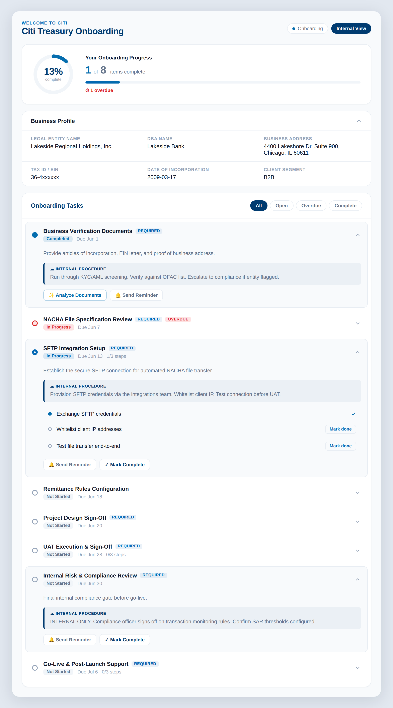
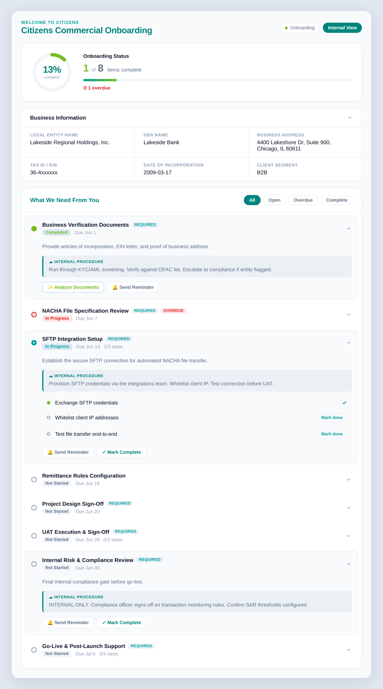
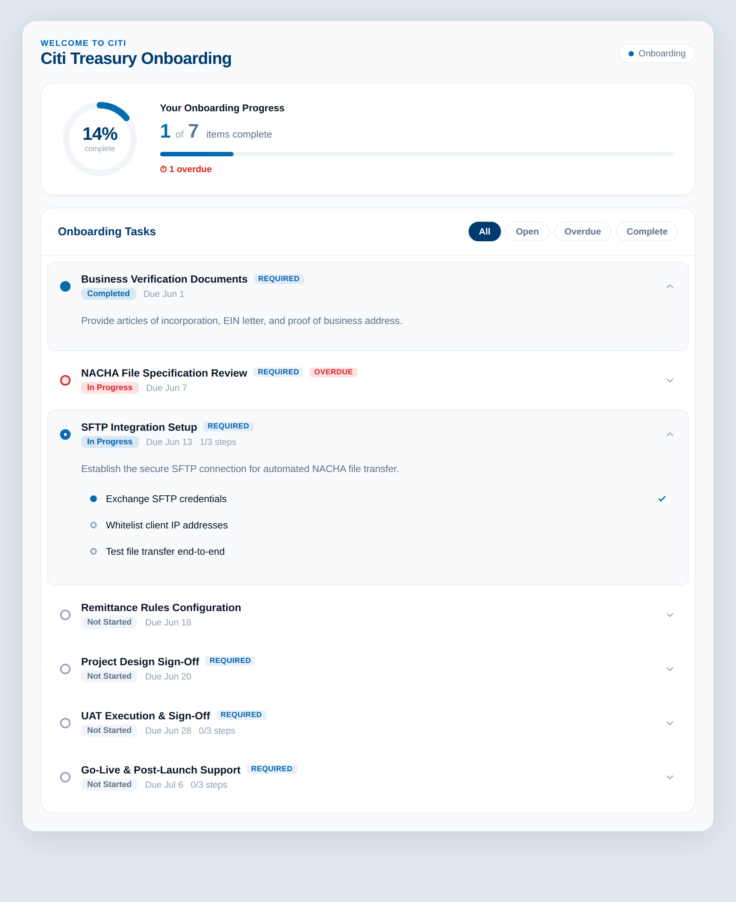
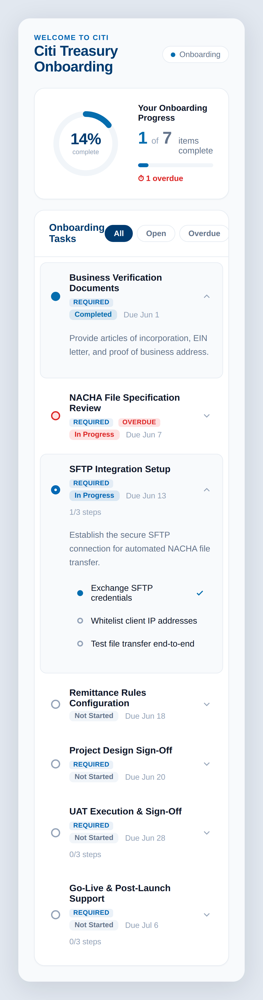

# 🏦 Onboarding Hub

### A white-label client & employee onboarding platform for Salesforce
**Service Cloud · Experience Cloud · Agentforce-ready**

> One configurable dashboard that rebrands per bank (Citi, Citizens, ICE…) by changing a single field. Covers B2B/B2C onboarding, KYC, integration setup, and enablement — with an internal ops view, a client-facing Experience Cloud portal, and Agentforce service-agent access.

---



---

## The three phases

| Phase | What it adds |
|---|---|
| **Phase 1 — Platform** | The data model (`Checklist__c` → `Checklist_Item__c` → `Checklist_Item_Step__c` + `Dashboard_Config__c`), the `onboardingHub` dashboard LWC, the cacheable controller with server-side portal filtering, Agentforce actions, and instant per-bank rebranding. |
| **Phase 2 — AI document intelligence** | A client uploads a document, an AI reads it (Agentforce Models API), the KYC business fields populate on the record, the item auto-completes above a confidence threshold, and low-confidence extractions route to a human. Adds the `onboardingDocUpload` + `onboardingPortal` LWCs and a Prompt Builder template. |
| **Phase 3 — Engine** | A scheduled reminder/escalation engine, multi-channel notifications (Email + in-app bell real; Slack + SMS config-gated), and PDF document generation + email-back. Adds `Notification_Log__c` and an escalation ladder. |

## Previews

| Internal · Citi | Internal · Citizens (one-field rebrand) |
|---|---|
|  |  |

| External portal | Portal on mobile |
|---|---|
|  |  |

Full walkthrough — architecture, configuration, usage, and limitations: **[`OnboardingHub_SOLUTION_GUIDE.md`](OnboardingHub_SOLUTION_GUIDE.md)**.

## Repository layout

```
onboarding-hub/
├── README.md
├── OnboardingHub_SOLUTION_GUIDE.md     all-phases solution guide
├── PHASE1_GUIDE.md                     Phase 1 detail
├── OnboardingHub_Phase1_DemoData.apex  Phase 1 demo data
├── docs/preview/                       rendered screenshots + HTML mockups
├── force-app/  +  sfdx-project.json    Phase 1 SFDX project (root)
├── phase2/                             Phase 2 SFDX project  (AI doc intelligence)
└── phase3/                             Phase 3 SFDX project  (reminders, notifications, doc-gen)
```

Each phase is its own source-format SFDX project, deployed in order against the same org.

## Quick start

```bash
# Phase 1 (root)
sf project deploy start --source-dir force-app --target-org <alias> --ignore-conflicts
sf org assign permset --name OnboardingHub_Admin --target-org <alias>
sf apex run --file ./OnboardingHub_Phase1_DemoData.apex --target-org <alias>

# Phase 2
sf project deploy start --source-dir phase2/force-app --target-org <alias> --ignore-conflicts

# Phase 3
sf project deploy start --source-dir phase3/force-app --target-org <alias> --ignore-conflicts
sf org assign permset --name OnboardingHub_Phase3 --target-org <alias>
```

Then drop the **Onboarding Hub** component on a Lightning page, set **Internal View** and **Branding Config Name** (`Citi` / `Citizens`), and point it at a checklist.

## Prerequisites

- Einstein Generative AI **ON**; the running user has **Einstein Generative AI User** (Phase 2).
- Assign the `OnboardingHub_Admin` and `OnboardingHub_Phase3` permission sets (field-level security).
- Assign the `Checklist__c` **Client** / **Employee** record types on the relevant profiles.

---

*API version 62.0 · source-format SFDX · no managed package.*
